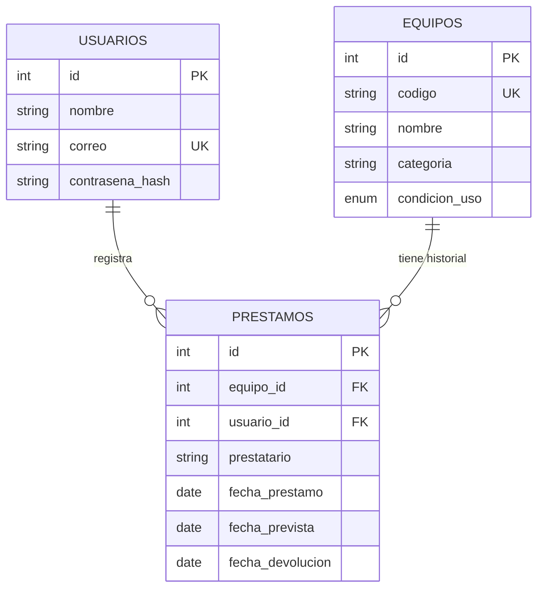

# API de préstamos de equipos de laboratorio

Proyecto grupal · **SENATI Huánuco – CFP Amarilis** · Curso: Fullstack Developer Software · Instructor: Ing. Darwin Uzuriaga Claudio

API REST con **Node.js + Express + MySQL + Sequelize** y autenticación **JWT** que permite registrar equipos de laboratorio, controlar sus préstamos y devoluciones, e impedir que un mismo equipo tenga dos préstamos activos.

## Equipo y distribución de responsabilidades

> Complete esta tabla con los datos reales del grupo. Cada integrante debe tener commits propios en GitHub.

| Integrante | Responsabilidad principal | Archivos / módulos |
| --- | --- | --- |
| _Nombre 1_ | Base de datos: modelos, migraciones y seeders | `src/models`, `src/migrations`, `src/seeders` |
| _Nombre 2_ | Autenticación y seguridad: JWT, hash, middleware | `src/middleware`, `src/controllers/auth.controller.js`, `src/utils/jwt.js` |
| _Nombre 3_ | Equipos y préstamos: reglas de negocio | `src/controllers`, `src/services`, `src/routes` |
| _Nombre 4_ | Pruebas y documentación: Postman, tests, informe | `tests`, `docs`, `README.md` |

## Características

- CRUD de equipos con código único, categoría y condición de uso; disponibilidad calculada.
- Préstamos con responsable (usuario autenticado), prestatario, fechas y devolución.
- **Un solo préstamo activo por equipo, garantizado en 3 capas:** transacción con bloqueo de fila, verificación explícita y **índice único en MySQL** (columna generada). Probado con 12 solicitudes simultáneas.
- Registro/login con **contraseñas en hash (bcrypt)** y **JWT (HS256, con expiración)**; rutas de equipos y préstamos protegidas.
- Validación de entradas con **Zod** (rechaza campos desconocidos), mensajes en español por campo.
- Consultas con filtros y paginación; historial por equipo; préstamos activos y vencidos.
- Seguridad adicional: `helmet`, CORS por lista blanca, límite de peticiones (más estricto en login), cuerpo máximo de 10 KB, errores sin filtrar detalles internos, protección contra enumeración de usuarios, consultas solo mediante el ORM.
- **69 pruebas automáticas** (Jest + Supertest) y colección de Postman con 29 solicitudes verificadas.

## Requisitos

- Node.js 18 o superior y npm (compruebe con `node -v` y `npm -v` en la terminal de Visual Studio Code)
- MySQL 8 (o MariaDB 10.5+) en ejecución
- Git

## Instalación (desde una copia limpia)

```bash
# 1. Obtener el código
git clone <URL-DEL-REPOSITORIO> lab-prestamos-api
cd lab-prestamos-api

# 2. Instalar dependencias
npm install

# 3. Crear la base de datos y un usuario de MySQL (edite antes la contraseña del archivo)
mysql -u root -p < database/crear_base.sql

# 4. Configurar variables de entorno
cp .env.example .env          # en Windows (CMD): copy .env.example .env
#    Abra .env y complete DB_USER, DB_PASSWORD y JWT_SECRET. Para generar un secreto:
node -e "console.log(require('crypto').randomBytes(48).toString('hex'))"

# 5. Crear las tablas (migraciones) y cargar datos de prueba ficticios
npm run db:migrate
npm run db:seed

# 6. Iniciar el servidor
npm start            # o:  npm run dev  (reinicia solo al guardar cambios)
```

El servidor queda en `http://localhost:3000/api`. Compruebe: `GET http://localhost:3000/api/health`.

**Usuario de demostración** (creado por el seeder, datos ficticios): `demo@laboratorio.test` / `Demo12345`.

### Scripts disponibles

| Comando | Acción |
| --- | --- |
| `npm start` | Inicia el servidor |
| `npm run dev` | Inicia con recarga automática (nodemon) |
| `npm run db:migrate` | Ejecuta las migraciones pendientes |
| `npm run db:migrate:undo` | Revierte todas las migraciones |
| `npm run db:seed` | Inserta los datos de prueba |
| `npm run db:reset` | Borra y recrea todo con datos de prueba |
| `npm test` | Ejecuta las pruebas automáticas (usa la base `laboratorio_prestamos_test`) |
| `npm run evidencias` | Ejecuta el escenario real y regenera `docs/EVIDENCIAS.md` |
| `npm run postman` | Regenera `docs/Coleccion_Postman.json` |

## Interfaz web

Al iniciar el servidor (`npm run dev`) abra **http://localhost:3000/** en el navegador (use el puerto que muestre la consola).
**Acceso libre:** escriba cualquier correo y cualquier contraseña (o déjelos vacíos) y entra; si el correo no existe se crea solo.
Esto lo controla `ACCESO_LIBRE=true` en `.env` (se ignora en producción). Para exigir credenciales reales, póngalo en `false` y use `POST /api/auth/registro` y `/api/auth/login`.
Desde la interfaz puede: ver el resumen, buscar/filtrar equipos, crear, editar y eliminar equipos, registrar préstamos,
registrar devoluciones y consultar el historial de cada equipo. Los archivos están en `public/` (`index.html`, `css/styles.css`, `js/app.js`).

## Solución de problemas (Windows)

**`EADDRINUSE: address already in use :::3000`** — el puerto ya lo usa otro proceso (normalmente otra terminal con `npm run dev`).
En desarrollo el servidor ahora prueba solo con el siguiente puerto libre (3001, 3002...) y muestra la URL real en consola.
Para liberar el 3000 manualmente:

```powershell
netstat -ano | findstr :3000
taskkill /PID <numero_pid> /F
```

Prueba rápida: abre `http://localhost:3000/api/auth/login` con Postman (POST) usando
`{"correo":"demo@laboratorio.test","contrasena":"Demo12345"}`.

## Variables de entorno (`.env.example`)

| Variable | Descripción |
| --- | --- |
| `PORT` | Puerto del servidor (3000) |
| `DB_HOST`, `DB_PORT`, `DB_NAME`, `DB_USER`, `DB_PASSWORD` | Conexión a MySQL |
| `DB_NAME_TEST` | Base separada para las pruebas (no toca sus datos reales) |
| `JWT_SECRET` | Secreto de firma (mínimo 32 caracteres; el servidor no arranca sin él) |
| `JWT_EXPIRES_IN` | Vigencia del token (por defecto `2h`) |
| `BCRYPT_ROUNDS` | Costo del hash de contraseñas (por defecto 12) |
| `CORS_ORIGINS` | Orígenes de navegador permitidos, separados por coma |
| `APP_TIMEZONE` | Zona horaria para "hoy" (por defecto `America/Lima`) |
| `RATE_LIMIT_AUTH_MAX`, `RATE_LIMIT_API_MAX` | Peticiones por IP cada 15 min (login/registro y resto) |

`.env` y `node_modules` están excluidos en `.gitignore`; solo se sube `.env.example`, sin secretos.

## Modelo de datos



- **Disponibilidad:** un equipo está disponible si no tiene un préstamo con `fecha_devolucion` vacía.
- **Condición de uso:** `bueno`, `regular`, `en_mantenimiento`, `fuera_de_servicio`. Solo `bueno` y `regular` pueden prestarse.
- **Restricciones en la base de datos:** claves foráneas `ON DELETE RESTRICT`; `CHECK` de coherencia de fechas; índice único `uq_prestamos_un_activo_por_equipo` sobre la columna generada `equipo_activo_id` (vale `equipo_id` mientras el préstamo está activo y `NULL` al devolverse).

## Estructura del proyecto

```
src/
  app.js, server.js        Express y arranque (cierre ordenado)
  config/                  Variables de entorno y conexión
  models/                  Usuario, Equipo, Préstamo y relaciones (Sequelize)
  migrations/, seeders/    Esquema versionado y datos de prueba
  middleware/              autenticar (JWT), validar (Zod), manejo de errores
  routes/, controllers/    Capa HTTP
  services/                Reglas de negocio de préstamos (transacciones)
  validators/              Esquemas Zod
  utils/                   JWT, fechas, errores, respuestas
tests/                     Pruebas automáticas (Jest + Supertest)
scripts/                   Generadores de evidencias y colección Postman
docs/                      Colección Postman, evidencias, documentación de pruebas
```

## Rutas de la API

Todas las rutas, salvo `health`, registro y login, requieren `Authorization: Bearer <token>`.

| Método | Ruta | Operación | Códigos |
| --- | --- | --- | --- |
| GET | `/api/health` | Estado del servicio | 200 |
| POST | `/api/auth/registro` | Crear usuario | 201, 400, 409 |
| POST | `/api/auth/login` | Obtener token JWT | 200, 400, 401 |
| GET | `/api/auth/perfil` | Usuario del token | 200, 401 |
| GET | `/api/equipos` | Listar equipos | 200, 400, 401 |
| POST | `/api/equipos` | Crear equipo | 201, 400, 401, 409 |
| GET | `/api/equipos/:id` | Consultar (incluye `prestamo_activo`) | 200, 400, 401, 404 |
| PUT | `/api/equipos/:id` | Actualizar (basta con enviar los campos a cambiar) | 200, 400, 401, 404, 409 |
| DELETE | `/api/equipos/:id` | Eliminar (si no tiene historial) | 200, 401, 404, 409 |
| GET | `/api/equipos/:id/historial` | Historial de préstamos del equipo | 200, 401, 404 |
| GET | `/api/prestamos` | Listar préstamos con filtros | 200, 400, 401 |
| POST | `/api/prestamos` | Registrar préstamo | 201, 400, 401, 404, 409 |
| GET | `/api/prestamos/:id` | Consultar un préstamo | 200, 401, 404 |
| PUT | `/api/prestamos/:id/devolucion` | Registrar devolución | 200, 400, 401, 404, 409 |

### Parámetros de consulta

**`GET /api/equipos`**: `page` (1), `limit` (20, máx. 100), `q` (busca en código y nombre), `categoria`, `condicion_uso`, `disponible` (`true`/`false`).

**`GET /api/prestamos`**: `page`, `limit`, `activos` (`true` = sin devolver, `false` = devueltos), `vencidos=true` (activos con fecha prevista pasada), `equipo_id`, `prestatario` (búsqueda parcial). Los filtros se pueden combinar, por ejemplo `/api/prestamos?activos=true&equipo_id=3`.

### Formato de las respuestas

```json
{ "ok": true,  "data": { }, "meta": { "total": 8, "page": 1, "limit": 20, "paginas": 1 } }
{ "ok": false, "error": { "codigo": "DATOS_INVALIDOS", "mensaje": "…", "detalles": [ { "campo": "correo", "mensaje": "…" } ] } }
```

### Cuerpos de ejemplo

```jsonc
// POST /api/auth/registro
{ "nombre": "Alumno Demo", "correo": "alumno@demo.test", "contrasena": "Clave12345" }

// POST /api/equipos
{ "codigo": "LAB-050", "nombre": "Osciloscopio digital", "categoria": "Electrónica", "condicion_uso": "bueno" }

// POST /api/prestamos   (fecha_prestamo es opcional: por defecto, hoy)
{ "equipo_id": 1, "prestatario": "Ana Torres Quispe", "fecha_prestamo": "2026-11-02", "fecha_prevista": "2026-11-07" }

// PUT /api/prestamos/1/devolucion   (ambos campos son opcionales)
{ "fecha_devolucion": "2026-11-06", "condicion_uso": "regular" }
```

## Pruebas

**Automáticas:** `npm test` crea desde cero la base `laboratorio_prestamos_test` con las migraciones reales y ejecuta 69 pruebas. Cubren los 8 casos obligatorios y además: concurrencia, restricciones de la base de datos, tokens manipulados/expirados/`alg=none`, inyección SQL, límites y cabeceras de seguridad.

**Postman:** importe `docs/Coleccion_Postman.json`, defina `baseUrl` (por defecto `http://localhost:3000`) y ejecute la colección con el *Collection Runner*. El login guarda el token automáticamente y cada solicitud verifica su código esperado.

**Evidencias:** `docs/EVIDENCIAS.md` contiene cada solicitud con su cuerpo, código y respuesta reales. `docs/PRUEBAS.md` resume los casos obligatorios.

## Trabajo colaborativo con GitHub

```bash
git init && git add . && git commit -m "feat: estructura inicial del proyecto"
git branch -M main
git remote add origin <URL-DEL-REPOSITORIO>
git push -u origin main
```

Recomendado: una rama por integrante o por funcionalidad (`git switch -c feat/prestamos`), commits pequeños con mensajes claros (`feat:`, `fix:`, `docs:`, `test:`) y *Pull Request* para unir los cambios. Los aportes de cada integrante quedan visibles en `git log --author="Nombre"`.

## Seguridad: resumen

- Contraseñas con **bcrypt**; nunca se devuelven ni se registran.
- **JWT** con algoritmo fijado (HS256) y expiración; el secreto se lee de `.env` y se exige un mínimo de 32 caracteres.
- Todas las consultas pasan por **Sequelize** (consultas parametrizadas); los comodines `%` y `_` de las búsquedas se escapan.
- **CORS** controla qué orígenes de navegador pueden leer respuestas; **no** reemplaza la autenticación, que la resuelve el JWT.
- La API devuelve únicamente JSON. La interfaz de `public/` ya muestra los datos como texto (`textContent`) o con codificación de salida para evitar XSS.
- Datos de prueba 100 % ficticios.

## Fuentes y herramientas de apoyo utilizadas

Documentación oficial de Node.js, Express, Sequelize, Zod, `jsonwebtoken` y MySQL; material de la sesión 07 (Grupo_5); asistente de IA (Claude) como apoyo para estructurar y revisar el código. Todo el equipo revisó, ejecutó y puede explicar el código entregado.

## Nota sobre dependencias

`npm audit` reporta una alerta en `zod` (agotamiento de memoria al validar colecciones muy grandes) y otra en `uuid` (dependencia interna de Sequelize, solo si se le entrega un buffer). Ninguna es explotable en este proyecto: no se validan arreglos y el cuerpo de las solicitudes está limitado a 10 KB; Sequelize no usa `uuid` con buffers. Pasar a Zod 4 queda como mejora futura, ya que implica cambios en los esquemas.
